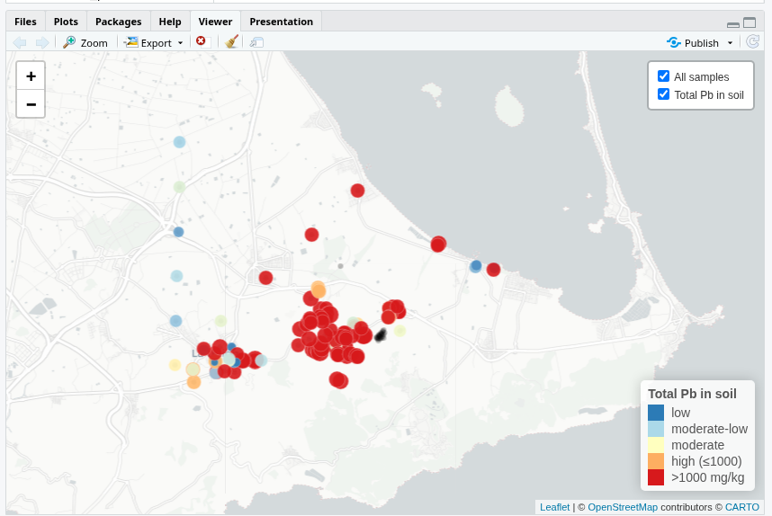
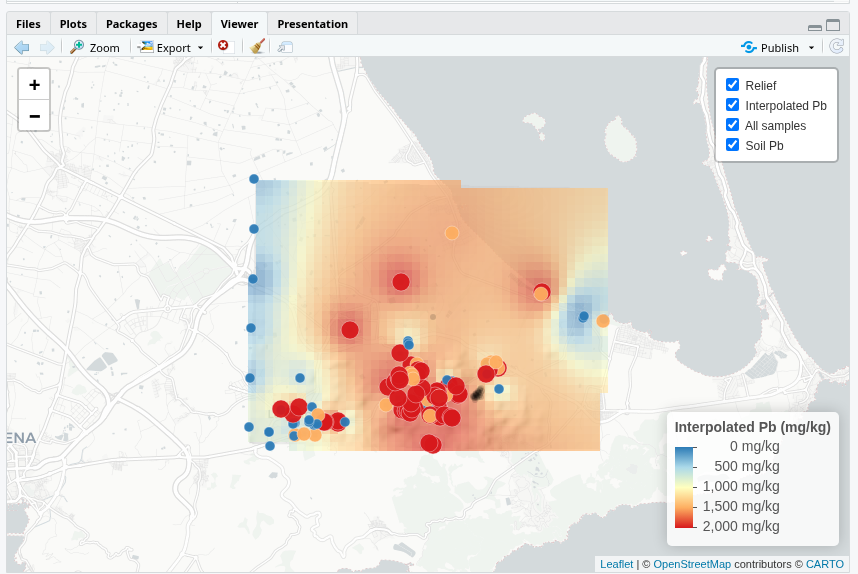
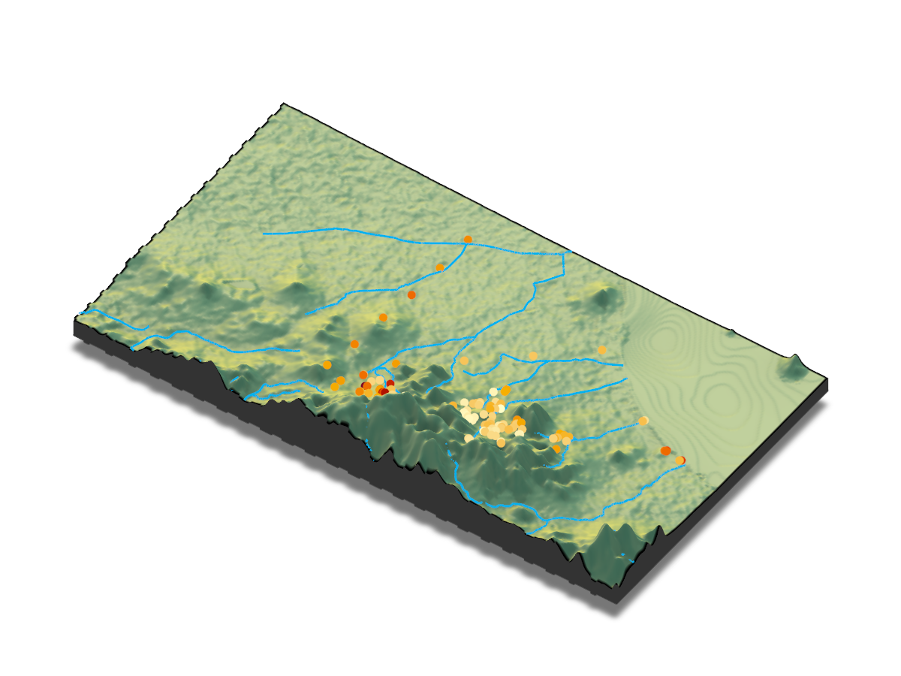

# Sierra Minera Spatial Software – Reproducible Multi-element Mapping in R

[](https://doi.org/10.5281/zenodo.19441307)

**Sierra Minera Spatial Software** provides reproducible workflows in **R** to integrate heterogeneous soil geochemistry datasets from the Sierra Minera mining district (Cartagena–La Unión, SE Spain) and generate **multi-element soil maps (Pb, Zn, As, Cd)**.

The code reorganizes raw laboratory spreadsheets into a spatial master table and uses that harmonized dataset to produce both exploratory and interpolated maps.

This repository contains the software for data harmonization, spatial analysis and mapping.
The source dataset is archived separately in Zenodo; the DOI badge above identifies
that dataset, not a software release.

## English project branch

This `projects/english` branch provides English documentation, source comments,
console messages and map labels. Original dataset identifiers, geographic names
and column-matching patterns are retained to preserve compatibility with the
source data.

```bash
git clone --branch projects/english https://github.com/TabErrans/sierra-minera-spatial-software.git
cd sierra-minera-spatial-software
```

---

# Table of Contents

* [Overview](#overview)
* [Context](#context)
* [Reproducible Method](#reproducible-method)
* [Scripts](#scripts)
* [Results](#results)
* [3D Terrain Visualization](#3d-terrain-visualization)
* [Interactive Map](#interactive-map)
* [Data Availability](#data-availability)
* [Data Sources](#data-sources)
* [Repository Structure](#repository-structure)
* [Status](#status)

---

# Overview

The purpose of this software is to generate **multi-element soil maps** for the Sierra Minera from heterogeneous geochemical datasets.

The method consists of three main steps:

1. Load heterogeneous Excel datasets
2. Harmonize sample identifiers and UTM coordinates
3. Generate multi-element maps in R from the harmonized spatial dataset

The resulting workflow enables reproducible spatial analysis and visualization of trace elements in soils.

---

# Context

The datasets originate from soil geochemistry studies conducted in the Sierra Minera mining district.

The datasets used in this repository originate from soil geochemistry studies conducted by **José Matías Peñas Castejón** and collaborators in the Sierra Minera mining district (Cartagena–La Unión, SE Spain).

The software reorganizes these heterogeneous sources into a harmonized spatial dataset suitable for open scientific analysis and cartographic visualization in **R**.

---

# Reproducible Method

## Multi-element Mapping Workflow

The software implements the following workflow:

```text
Raw Excel datasets
        ↓
Harmonization of sample IDs and UTM coordinates
        ↓
Construction of a master spatial table
        ↓
Extraction of total soil element concentrations (Pb, Zn, As, Cd)
        ↓
Interactive mapping in R (Leaflet)
        ↓
IDW interpolation and raster visualization with hillshade
```

## 3D Terrain Visualization Workflow

The repository also includes an experimental 3D visualization workflow:

```text
Master spatial table + total element concentrations
        ↓
Integration of elevation data (DEM)
        ↓
Integration of official drainage network (CNIG)
        ↓
3D terrain visualization (rayshader)
```

The raw data can be downloaded from Zenodo and placed in the local input folder `data/raw/`.

Once configured, the scripts allow the user to reproduce all maps directly in **R**.

---

# Scripts

The reproducible code is located in the `scripts/` directory.

The repository uses a thematic script classification system. Script codes indicate the role of each workflow component rather than execution order.

For additional details, see:

**[SCRIPT_CODES.md](SCRIPT_CODES.md)**

---

## `scripts/0_build_samples_master.R`

Builds the harmonized spatial master table from heterogeneous spreadsheets.

Main tasks:

* load multiple Excel files
* normalize field sample identifiers
* extract UTM coordinates
* review duplicated coordinate records
* construct a master spatial table

---

## `scripts/2_build_geo_total_elements_wide.R`

Combines spatial and geochemical information into a single georeferenced dataset.

Main tasks:

* load or generate the master sample table
* retrieve elevation values from a Digital Elevation Model (DEM)
* join coordinates and elevation data
* integrate total element concentrations
* generate a unified geospatial geochemistry table

---

## `scripts/1_map_total_elements_leaflet.R`

Creates an interactive **Leaflet map of total soil element concentrations (Pb, Zn, As, Cd)**.

Main tasks:

* visualize sampling locations
* display multiple soil elements
* generate interactive map layers
* provide dynamic element selection

---

## `scripts/1_leaflet_idw_total_elements_map.R`

Generates interpolated **multi-element surfaces** using **Inverse Distance Weighting (IDW)** and overlays them on a DEM-derived hillshade.

Main tasks:

* interpolate element concentrations
* generate raster surfaces
* overlay terrain relief (hillshade)
* visualize multi-layer outputs interactively

---

## `scripts/1_map_pb_terrain_3d.R`

Creates an experimental 3D terrain visualization of the Sierra Minera using a Digital Elevation Model (DEM), Pb concentrations and the official drainage network.

Main tasks:

* generate a reduced DEM for 3D rendering
* visualize Pb concentrations in three dimensions
* integrate official hydrographic network data
* create interactive terrain visualizations with rayshader
* export PNG and HTML outputs

---

# Results

Example outputs generated by the reproducible code.

## Sampling points and element concentrations



## Interpolated raster surface (example: Pb)



---

# 3D Terrain Visualization

⚠️ **Work in progress**

The 3D visualization workflow is currently under active development and should be considered a first proof-of-concept rather than a final analytical product.

The objective is to integrate:

* Digital Elevation Models (DEM)
* Harmonized soil geochemistry datasets
* Pb sampling locations
* Official drainage network
* Future interpolated contamination surfaces

The current prototype combines terrain elevation, Pb concentrations and the official hydrographic network to explore potential relationships between topography, drainage pathways and contaminant distribution.

## Example output



## Interactive Viewer

[Open 3D Viewer](figures/pb_terrain_3d.html)

## Data sources

The drainage network used in the 3D visualization was obtained from the Spanish National Centre for Geographic Information (CNIG) hydrography dataset:

https://centrodedescargas.cnig.es/CentroDescargas/hidrografia

Future versions of the workflow may incorporate:

* multi-element 3D visualization
* interpolated contamination surfaces
* surface runoff modelling
* watershed analysis
* human exposure and environmental risk layers

---

# Interactive Map

An interactive multi-element map (IDW + hillshade) is available online:

🔗 **[Open interactive map](https://rpubs.com/Cpurpurea/sierra-minera-multielement-idw-map)**

This map allows exploration of:

* multiple soil elements (Pb, Zn, As, Cd)
* interpolated surfaces
* sampling point data
* terrain context

## Topographic background

2D and IDW maps use the IGN/CNIG topographic WMS layer `mtn_rasterizado` by
default. It requires internet access. Select **Local terrain** in the layer
control to use the embedded DEM background without remote map tiles. IDW's
optional Relief overlay starts hidden to keep the IGN cartography clear.
The generated HTML must remain alongside its resource directory.

Regenerate existing maps with `./scripts/run.sh --2d --idw`. The master launcher
uses `data/spatial/terrain_dem.tif` automatically when present; `--dem FILE`
overrides it. If no local DEM is supplied, IDW elevation retrieval needs a
connection. Local terrain coverage is limited to the raster extent and does
not include street names. IGN/CNIG attribution is displayed on the maps.

---

# Data Availability

The raw soil geochemistry datasets used in this repository are archived in Zenodo
as **Sierra Minera Soil Geochemistry Legacy Dataset (Anonymized Source Files, SE Spain)**,
version **v2.0-anonymized**:

https://doi.org/10.5281/zenodo.19441307

Download `data_sierra_minera_v2_anonymized.zip` from that record. For the Linux
launcher, extract the source spreadsheets into `data/raw/`.

This repository does not duplicate the archived raw dataset. Instead, it provides the reproducible R workflow required to integrate and analyze the data.

A harmonized geospatial dataset can be kept locally for reproducibility. All of
`data/` is ignored by Git, including these reference files:

* `data/geo_total_elements_wide.csv`
* `data/geo_total_elements_wide.rds`

---

# Data Sources

## Soil geochemistry

The geochemical data derive from research carried out by **José Matías Peñas
Castejón** and collaborators in the Sierra Minera mining district. The source
spreadsheets are archived in [Zenodo, version v2.0-anonymized](https://doi.org/10.5281/zenodo.19441307).
The workflow harmonizes these sources into reusable spatial tables while
preserving the original input files.

## Elevation and local terrain

Elevation is supplied through `elevatr` or a local DEM selected with `--dem`.
The prepared `data/spatial/terrain_dem.tif` is also used by the 3D workflow and
local background layer. Its provenance is separate from the IGN topographic
basemap described below; using an IGN background does not change the source of
the elevation values or soil measurements.

## Hydrography

The prepared drainage layer originates from the **IGN/CNIG IGR Hydrography**
dataset for the Segura basin. The local file is `data/spatial/drainage.gpkg`,
with layer `drainage`.

Source: [CNIG Hydrography Download Centre](https://centrodedescargas.cnig.es/CentroDescargas/hidrografia).

## IGN topographic basemap and attribution

The topographic background is provided by the **Instituto Geográfico Nacional
de España (IGN)** through its *Cartografía ráster* WMS service.

- [Official IGN web-service catalogue](https://www.ign.es/web/ign/portal/ide-area-nodo-ide-ign)
- [Service capabilities](https://www.ign.es/wms-inspire/mapa-raster?SERVICE=WMS&REQUEST=GetCapabilities&VERSION=1.1.1)
- Layer: `mtn_rasterizado`; service: `https://www.ign.es/wms-inspire/mapa-raster`.
- [IGN/CNIG usage and attribution conditions](https://www.ign.es/resources/licencia/Condiciones_licenciaUso_IGN.pdf)

Maps display **© Instituto Geográfico Nacional de España**, the attribution
specified by the service's access conditions. Keep this credit visible when
sharing maps or exporting screenshots. The IGN background requires internet
access; the selectable local terrain remains available without remote tiles.

---

# Repository Structure

The repository uses a thematic script classification system. Script codes indicate their role within the workflow rather than execution order.

For a detailed description of the coding scheme, see:

**[SCRIPT_CODES.md](SCRIPT_CODES.md)**

```text
.
├── README.md
├── SCRIPT_CODES.md
├── LICENSE
├── scripts/              # R workflows and run_test.sh launcher
├── tests/
│   ├── run_workflow.R    # R test runner
│   └── results/          # Test logs, summaries and maps (ignored)
├── data/
│   ├── geo_total_elements_wide.csv  # Local reference table (ignored)
│   ├── geo_total_elements_wide.rds  # Local reference table (ignored)
│   ├── raw/             # Local Excel inputs (ignored)
│   ├── prepared/        # Local reference tables (ignored)
│   ├── spatial/         # Local drainage and terrain (ignored)
│   └── processed/       # Reusable generated datasets (ignored)
├── outputs/
│   └── maps/            # Presentation HTML and images (ignored)
└── figures/             # Published example figures
```


---

# Status

The software currently provides reproducible workflows for:

* harmonization of heterogeneous soil geochemistry datasets
* construction of a spatial master table
* integration of elevation data
* interactive multi-element mapping
* IDW interpolation
* exploratory 3D terrain visualization

The project remains under active development.

Future developments may include:

* additional elements
* improved interpolation methods
* 3D contamination surfaces
* hydrological analyses
* statistical analysis of geochemical patterns
* integration with environmental and human exposure frameworks

## Master launcher

Run products directly with `scripts/run.sh`; flags can be combined:

```bash
./scripts/run.sh --2d
./scripts/run.sh --3d
./scripts/run.sh --idw
./scripts/run.sh --csv
./scripts/run.sh --all --dem data/spatial/terrain_dem.tif
```

The launcher resolves the checkout from its own location and shares prerequisites
in one R session. `--2d` and `--idw` save HTML plus companion resource directories
under `outputs/maps/`; keep those directories alongside the HTML. `--csv` writes
`samples_master.csv`, `total_elements_wide.csv`, `samples_geo.csv` and
`geo_total_elements_wide.csv` (plus its RDS copy) under `data/processed/`.
These reusable tables use the existing geospatial export schema.

The 2D, CSV and IDW paths require source Excel files in `data/raw/`. CSV and IDW
normally download elevation; `--dem FILE` supplies a local raster instead.
The 3D workflow uses
`data/spatial/terrain_dem.tif`, `data/spatial/drainage.gpkg` (layer `drainage`),
and the generated geospatial CSV if present, otherwise the local reference CSV.
The prepared terrain is already reduced and is not aggregated a second time.
3D outputs go to `outputs/maps/terrain_3d/`; rendering requires the appropriate
graphics support and self-contained HTML export requires Pandoc.

Existing named products may be overwritten. Failure stops the command with a
nonzero exit status; earlier completed products remain available. The test launcher keeps its artifacts under `tests/results/`.

## Workflow tests

Run `./scripts/run_test.sh all` to check all workflows, or select `master`,
`leaflet`, `geo`, `idw` or `terrain`. Install the R packages imported by the
scripts and supply the documented data before running. The tests use
`data/spatial/terrain_dem.tif` when present.

Logs, HTML previews and `summary.tsv` are saved under `tests/results/`.
Failed stages and stages blocked by failed prerequisites return a nonzero
exit status. These checks verify script execution; inspect the generated
maps in a browser to assess the remote basemap and visual quality.
